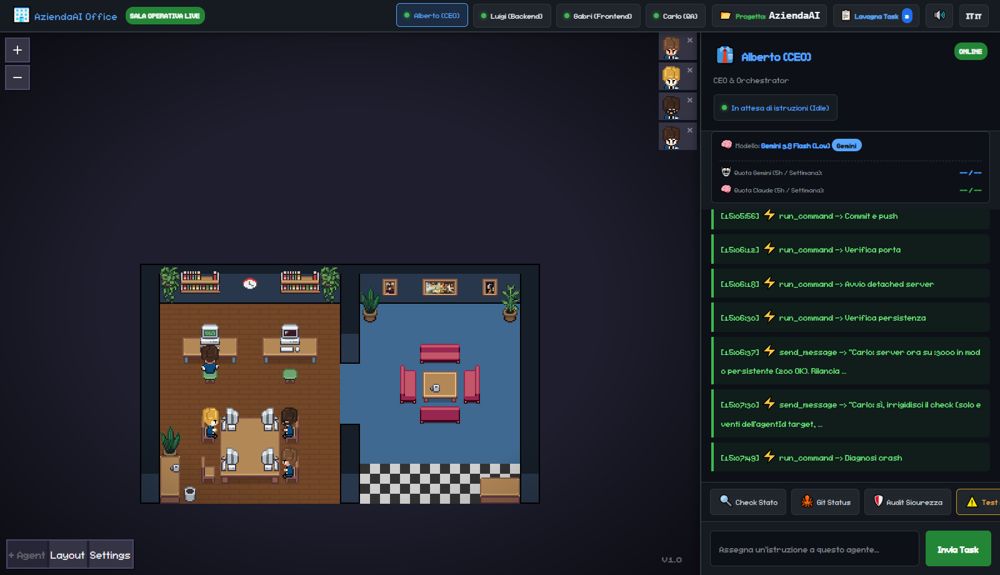

# 🏢 Easy Agent Office

**Guarda i tuoi agenti di Google Antigravity lavorare — in un ufficio 2D pixel.**

Gli agenti camminano, si riuniscono e delegano compiti da una scrivania all'altra.
Mostrano in tempo reale gli strumenti che usano.



---

## 🚀 Avvio in un click (Windows)

1. Tieni installato **Google Antigravity** (può anche essere chiuso: si apre da solo).
2. Fai doppio click su **`START.bat`**.

Lo script si occupa di tutto: controlla Node.js, avvia Antigravity, installa le dipendenze,
crea i 4 agenti se non esistono, avvia il server e apre **http://localhost:3000**.

---

## 🎮 Cosa vedrai

| Personaggio | Ruolo |
| --- | --- |
| 👔 Alberto | CEO — cammina dai colleghi per delegare |
| ⚙️ Luigi | Backend developer |
| 🎨 Gabri | Frontend developer |
| 🛡️ Carlo | QA e sicurezza |

### Modalità Easy (attiva di default)

Solo tre pulsanti grandi:

- 🚶 **Test Delegation** — Alberto cammina da Luigi
- ☕ **Sofa Break** — tutti vanno in sala relax
- 📢 **Call Standup Meeting** — tutti si riuniscono alla scrivania del CEO

Il pulsante **⚙️ Show All** nella barra in alto mostra tutte le funzioni avanzate.

---

## 🧠 Come funziona

```
Scrivi un compito
   ↓
Il compito arriva al vero agente Antigravity
   ↓
Antigravity scrive i log sul disco
   ↓
L'ufficio pixel legge i log
   ↓
Il personaggio si muove e mostra gli strumenti usati
```

L'ufficio non pensa: osserva i transcript locali di Antigravity
(`~/.gemini/antigravity/brain`) e li trasforma in animazioni.

---

## ⚙️ Personalizza il team

Modifica [`team.config.json`](./team.config.json) per cambiare nomi, ruoli, colori o
numero di agenti, poi esegui:

```powershell
npm run setup
```

---

## 📁 Repository

**https://github.com/NgoytryLyhuor/easy-agent-office**

---

## 📄 Licenza

MIT — vedi [`LICENSE`](./LICENSE). Il renderer 2D si basa su
[Pixel Agents](https://github.com/pablodelucca/pixel-agents) di Pablo De Lucca (MIT).
