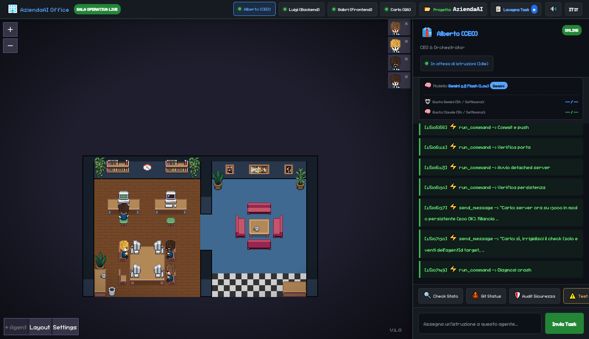

# 🏢 Easy Agent Office

**Watch your Google Antigravity agents work — as a 2D pixel office.**

Your agents walk to meetings, delegate tasks desk-to-desk, and show their live tool calls.
It is a visual dashboard for the agents that already run inside Antigravity.



---

## 🚀 Start in one click (Windows)

1. Keep **Google Antigravity** installed (it can be closed — the launcher opens it).
2. Double-click **`START.bat`**.

That's it. The script will:

- check Node.js
- start Antigravity if needed
- install packages if missing
- create your 4 agents if missing
- start the server and open **http://localhost:3000**

To start it again later, just double-click `START.bat` again.

---

## 🎮 What you will see

| Character | Role |
| --- | --- |
| 👔 Alberto | CEO — walks to teammates' desks to delegate |
| ⚙️ Luigi | Backend engineer |
| 🎨 Gabri | Frontend engineer |
| 🛡️ Carlo | QA & security reviewer |

### Easy Mode (on by default)

Only three big buttons are shown:

- 🚶 **Test Delegation** — watch Alberto walk to Luigi
- ☕ **Sofa Break** — everyone goes to the lounge
- 📢 **Call Standup Meeting** — everyone gathers at the CEO's desk

Click the **⚙️ Show All** button in the top bar to reveal every advanced feature.

---

## 🧠 How it works

```
You type a task
   ↓
Task goes to the real Antigravity agent
   ↓
Antigravity writes logs on your disk
   ↓
The pixel office reads those logs
   ↓
The character moves and shows live tool calls
```

The office does **not** think. It only watches Antigravity's local transcripts
(`~/.gemini/antigravity/brain`) and animates what it sees.

---

## ⚙️ Customize your team

Edit [`team.config.json`](./team.config.json) to change names, roles, colors or the number
of agents, then run:

```powershell
npm run setup
```

---

## 📁 Repository

This is the maintained fork:
**https://github.com/NgoytryLyhuor/easy-agent-office**

```
origin   = your fork
upstream = the original MIT-licensed project
```

---

## 📄 License

MIT — see [`LICENSE`](./LICENSE). The original copyright notice is kept there as
required by the MIT license. The 2D canvas engine is based on the open-source
[Pixel Agents](https://github.com/pablodelucca/pixel-agents) renderer by Pablo De Lucca (MIT).
